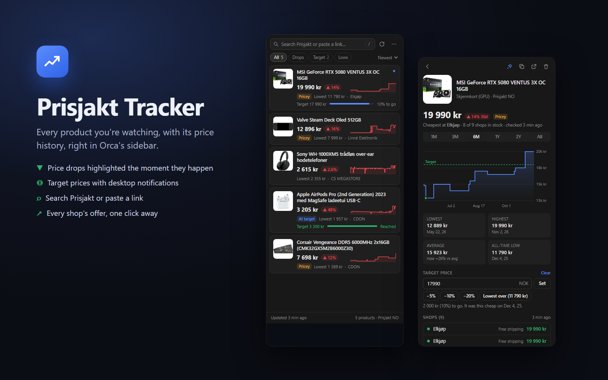

# Prisjakt Tracker for Orca

Keep an eye on the things you want to buy, right in [Orca](https://github.com/stablyai/orca)'s right sidebar. Search Prisjakt (or paste a link), and every product you track shows its current lowest price, how it moved, its price history and which shops have it — with a target price and a notification when it gets there.



## Install

In a terminal with the Orca CLI:

```sh
orca plugin install mathiassol/prisjakt-tracker
```

Orca lists what the plugin asks for and prints the command to approve it (`--approve <fingerprint>`); the Git URL `https://github.com/mathiassol/prisjakt-tracker` works too. Then open **Price Tracker** (the chart icon) in the right sidebar.

## What it does

- **Find products fast.** Type in the search box to get Prisjakt's own suggestions with pictures and prices, or paste any product link (`prisjakt.no/product.php?p=…`) or id and press <kbd>Enter</kbd>. Press <kbd>/</kbd> or <kbd>Ctrl/⌘ K</kbd> anytime to search; products you already track show up first.
- **See everything at a glance.** Each card shows the cheapest price you can actually buy (in-stock offers), the change over 30 days, a 90-day sparkline, the all-time lowest price and a verdict: *All-time low*, *1-year low*, *Near low* or *Pricey*.
- **Unseen drops stand out.** When a price falls after you last looked, the card gets a green edge and the drop since your last visit; the status bar says how many dropped.
- **Target prices.** Set your own, or one tap: −5 %, −10 %, −20 % or the lowest price ever. A progress bar shows how far there is to go, and a desktop notification fires once when any shop reaches it.
- **Full history.** Click a product for an interactive chart (1M · 3M · 6M · 1Y · 2Y · All) with your target line and the lowest point marked, plus the lowest, highest and average price for the range.
- **Every shop.** In-stock offers first, with stock status and shipping; click one to go to the shop.
- **Filters and sorting.** All · Drops · Target · Lows; sort by newest, biggest drop, nearest target, price or name. Pin favourites to the top (pin button, <kbd>P</kbd>, or right-click a card).
- **Background refresh.** Prices are checked every few hours while Orca runs, one product at a time and politely spaced.
- **Notes, compact rows, backups.** Write a note per product, switch to compact rows (<kbd>C</kbd>), add many links at once, export a backup (.json) or your prices (.csv), and import a backup.

### Keyboard

| Key | Action |
| --- | --- |
| <kbd>/</kbd>, <kbd>Ctrl/⌘ K</kbd> | Search or paste a link |
| <kbd>↑</kbd> <kbd>↓</kbd> <kbd>Enter</kbd> | Move through results or cards, open |
| <kbd>Shift</kbd>+<kbd>Enter</kbd> | Add a search result and open it |
| <kbd>R</kbd> | Refresh all prices |
| <kbd>C</kbd> | Toggle compact rows |
| <kbd>Esc</kbd> / <kbd>←</kbd> | Back to the list |
| <kbd>P</kbd> · <kbd>O</kbd> · <kbd>T</kbd> · <kbd>Del</kbd> | Pin · Open on Prisjakt · Edit target · Stop tracking |
| <kbd>1</kbd>–<kbd>6</kbd> | Chart range |

### Commands and status bar

- **Prisjakt: Refresh all prices** and **Prisjakt: Show price summary** in the command palette.
- A status bar item shows unseen drops (or items at target); click it to refresh.

### Settings

Under **Settings → Plugins → Prisjakt Tracker**:

| Setting | Default |
| --- | --- |
| Market for search | Prisjakt Norge |
| Refresh every (hours) | 4 |
| Notify at target price | on |
| Notify on new all-time low | on |
| Notify on every price drop | off |
| Ignore drops smaller than (%) | 1 |

Markets: Prisjakt Norge (prisjakt.no), Prisjakt Sverige (prisjakt.nu), Prisjagt Danmark, Hintaopas Suomi, PriceSpy UK and NZ. They all run the same site, so pasted links from any of them work.

## What it can access

It runs its own worker process (Orca's `trusted-worker`), and asks for:

- `storage:own`: your tracked list and cached thumbnails, in the plugin's own folder
- `settings:own`: the settings above
- `notifications:show`: price alerts

It only talks to the Prisjakt/PriceSpy site of each product and `cdn.pji.nu` (product pictures), using the same JSON endpoints their own pages use. It never touches your terminals, workspaces or files.

## Development

No build step: Orca transpiles the TypeScript worker when it loads, and the panel is plain HTML, CSS and JavaScript modules.

```sh
orca plugin dev watch . --check   # load this folder into Orca and reload on save
orca plugin test .                # worker tests (mock host + recorded Prisjakt responses) and core tests
npx tsc -p .                      # type-check (after `orca plugin types .`)
```

| Path | What |
| --- | --- |
| `src/worker.ts` | State, refresh schedule, notifications, status bar, panel request handlers |
| `src/prisjakt.ts` | The Prisjakt client: search, price history, offers, product name, thumbnails |
| `src/protocol.ts` | The panel ↔ worker contract |
| `panel/` | The sidebar UI (`index.html`, `style.css`, `app.js`) |
| `panel/core.js` | Shared pure logic: link parsing, price history maths, sorting, formatting |

Not affiliated with Prisjakt or PriceSpy. Prices come from their public site and can be wrong or late; always check the shop before you buy.

## License

MIT
